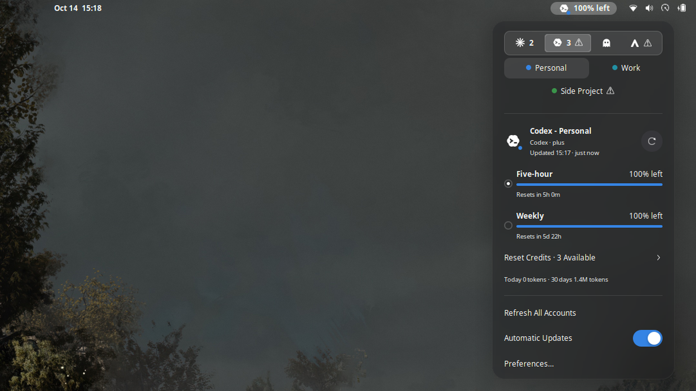
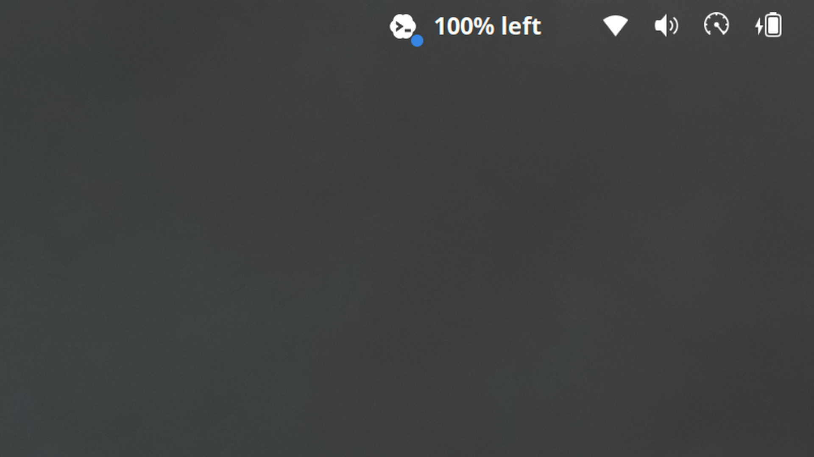

# Token Grill

Token Grill shows the usage limits of your AI accounts in the GNOME top bar.

Token Grill monitors more than one account at the same time. From the top bar,
you can see the remaining usage, select a different account, and see the reset
times.



## Functions

These are the functions of the top bar and the popup:

- Token Grill monitors Codex, Claude, Kiro, and Antigravity accounts. You can
  add more than one account for each service.
- The top bar shows the active account as text, as a ring, or as a bar.
- The popup shows the limits of each account and their reset times in your
  local time zone.
- You can select a different account in the popup.
- If a refresh gets an error, the popup keeps the last good values and shows
  the error.

These are the other functions:

- Token Grill can send a notification when the usage of an account becomes
  more than a usage step.
  The notification shows the percentage, the account, the limit, and the step.
- For Codex and Claude accounts, Token Grill can read the local session
  history. It keeps only token totals. It does not keep prompts or responses.
- For Codex accounts, the popup shows the number of available reset credits.
  Token Grill does not use a reset credit.



## Install

Token Grill operates only with **GNOME Shell 50**.

After GNOME Shell Extensions approves the first release, search for
**Token Grill** in [Extension Manager](https://mattjakeman.com/apps/extension-manager)
or on [GNOME Shell Extensions](https://extensions.gnome.org/). This method also
gives you the updates.

To install a release archive before the approval, do these steps:

1. Run this command:

   ```sh
   gnome-extensions install --force tokengrill@sh02sahil.github.io.shell-extension.zip
   ```

2. Log out and log in again.
3. Enable Token Grill in Extension Manager or in the Extensions app.

## Add an account

1. Sign in to the service with the CLI of that service. Token Grill does not
   sign in for you.
2. Open the preferences of Token Grill.
3. Go to the **Providers** page.
4. To find the accounts on this computer, select **Discover…**. To type the
   home directory of an account, select **Add Account…**.
5. Select the account for the top bar.
6. Select if Token Grill can read the local history of the account.

These are the usual home directories: `~/.codex`, `~/.claude`,
`$XDG_DATA_HOME/kiro-cli`, and `~/.gemini/antigravity-cli`. Each home directory
is a different account. For example, `~/.codex` and `~/.codex2` are two Codex
accounts.

## Optional system libraries

Two services must have a GObject introspection library from your Linux
distribution:

| Service | Library | Debian or Ubuntu package |
|---------|---------|--------------------------|
| Kiro | Gda 5.0 with the SQLite provider | `gir1.2-gda-5.0` |
| Antigravity CLI (keyring sign-in) | libsecret 1 | `gir1.2-secret-1` |

Token Grill loads a library with a dynamic `import()` only when an account
uses it. If a library is missing, only that account shows an error. All other
accounts continue to operate.

## Privacy and network access

Token Grill reads the credentials that the CLI of each service stored on this
computer. It sends these credentials only to that service. Token Grill
connects only to these hosts:

| Service | Host | Purpose |
|---------|------|---------|
| Codex | `chatgpt.com` | Usage limits and reset credits |
| Claude | `api.anthropic.com` | Usage limits |
| Kiro | `codewhisperer.us-east-1.amazonaws.com`, `q.<region>.amazonaws.com`, or the AWS ISO `q.*` host of your region | Usage limits |
| Kiro | `oidc.<region>.amazonaws.com` | A new token when the sign-in is expired |
| Antigravity | `cloudcode-pa.googleapis.com` | Plan and usage limits |
| Antigravity | `oauth2.googleapis.com` | A new token when the sign-in is expired |

Each request obeys these limits:

- The request goes only to a host on a fixed list.
- The request uses only HTTPS.
- Token Grill does not accept redirects.
- Token Grill stops after 1 MiB of response data.

Each request uses this User-Agent:

```text
TokenGrill (+https://github.com/sh02sahil/token-grill; usage monitor for Codex, Claude, Kiro and Antigravity)
```

The Antigravity quota service gives data only when the User-Agent contains
the word Antigravity. Thus, the User-Agent names all the services that Token Grill
monitors.

Token Grill does not start other programs. It does not collect telemetry. It
does not read or send prompts or responses.

The Kiro usage request gets the e-mail address of the account. The popup shows
this address. Thus, you can see which account `kiro-cli` uses. Token Grill does not
write the address to a file.

### Local files that Token Grill reads

Each account has a home directory. For each account, you can set a different
credential file and a different sessions directory.

For Codex and Claude accounts, Token Grill reads these files:

- Codex: `<home>/auth.json`. The default home is `~/.codex`. With local
  history, Token Grill also reads `<home>/sessions/` and
  `<home>/archived_sessions/`.
- Claude: `<home>/.credentials.json`. The default home is `~/.claude`. With
  local history, Token Grill also reads `<home>/projects/`.

For Kiro and Antigravity accounts, Token Grill reads these files:

- Kiro: `<home>/data.sqlite3`. The default home is `$XDG_DATA_HOME/kiro-cli`.
  Token Grill opens the database read-only, with the SQLite `query_only` guard.
  It reads the database again only after its size or modification time
  changes.
- Antigravity: the first of `acp_token.json`, `oauth_creds.json`, and
  `credentials.json` in the home. The default home is
  `~/.gemini/antigravity-cli`. **Discover…** also finds `~/.gemini/antigravity`,
  `~/.antigravity`, and `~/.config/Antigravity`.

If Token Grill cannot use an Antigravity credential file, it reads the Secret
Service item of the Antigravity CLI (`service=gemini`, `username=antigravity`).
Token Grill does not unlock a locked keyring.

If a Kiro or Antigravity access token is expired, Token Grill gets a new token.
It keeps the new token only in memory. It does not write the token to the files
or the keyring of the service.

### Files of Token Grill

- `$XDG_DATA_HOME/token-grill/` contains the usage totals.
- `$XDG_STATE_HOME/token-grill/` contains the history checkpoints and the
  notification state.

These files do not contain credentials, service responses, prompts, or
responses.

## Test a development build

Use a nested GNOME Shell with a separate data directory and a separate state
directory. Do these steps:

1. Run these commands:

   ```sh
   export XDG_DATA_HOME="$(mktemp -d)" XDG_STATE_HOME="$(mktemp -d)"
   npm ci
   npm run install:local
   npm run dev:shell
   ```

   `npm run dev:shell` starts `dbus-run-session -- gnome-shell --devkit --wayland`.
   The script enables Token Grill, disables it, and enables it again. After
   each step, it shows the state of the extension.

2. In a different terminal, look at the log:

   ```sh
   journalctl -f -o cat /usr/bin/gnome-shell
   ```

3. Lock and unlock the nested session one time. The script shows the commands.

CAUTION: The nested shell uses the same dconf database as your desktop. If you
change a preference in the nested shell, the preference also changes on your
desktop.
If you enable or disable an extension in the nested shell, the extension also
changes on your desktop.

For the full procedure, refer to [CONTRIBUTING.md](CONTRIBUTING.md).

## Why this exists

Token Grill started as a personal tool. I wanted one GNOME extension with these
functions:

- More than one account for each service.
- The services that I use when I write code.
- Small displays in the top bar.
- Clear reset times.
- Local history that keeps prompts and responses private.

I did not find an extension with all these functions. Thus, I made this
extension, and I share it.

The first release monitors Codex, Claude, Kiro, and Antigravity, because I use
these services. Token Grill can monitor more services in the future, if they
do not decrease the privacy or the reliability of the extension.

## AI development declaration

AI played a substantial role in Token Grill's development. The project was
created for personal use with **OpenAI GPT-5.6 Sol**, using medium reasoning
through **Codex**. **T3 Code** served as the agentic coding environment and
orchestration interface around Codex.

AI assistance covered design exploration, implementation, refactoring, tests,
security review, and documentation. I directed that work, tested the resulting
extension, reviewed what is published, and remain responsible for maintaining
and explaining the code.

## Troubleshooting

- **Sign-in required:** Open the CLI of the service and sign in again.
- **Kiro database unreadable:** Install the Gda 5.0 SQLite library. Then close
  the preferences window and open it again.
- **System keyring or libsecret 1 unavailable:** Install the libsecret 1
  library, or sign in to Antigravity with a credential file.
- **Antigravity CLI sign-in expired:** Run an `agy` command. The Antigravity CLI
  then gets a new token.
- **No history:** Enable local history for the account. Make sure that the
  session directory of the account is present.
- **Changes do not show:** Disable the extension and enable it again. On
  Wayland, log out and log in again after you replace the extension files.
- **A service changed its API:** Open an issue with the error text. Do not
  attach credentials or a session log from your computer.

## Contributing

We accept bug reports and small pull requests. Before you share logs or account
data, read [CONTRIBUTING.md](CONTRIBUTING.md).

## Independence and license

Token Grill is an independent project. OpenAI, Anthropic, Amazon, and Google do
not endorse or sponsor Token Grill. Token Grill uses the service names only to
identify each service. The service icons are original symbolic drawings. Refer
to [NOTICE.md](NOTICE.md).

The license of Token Grill is GPL-3.0-or-later. Refer to [LICENSE](LICENSE).
